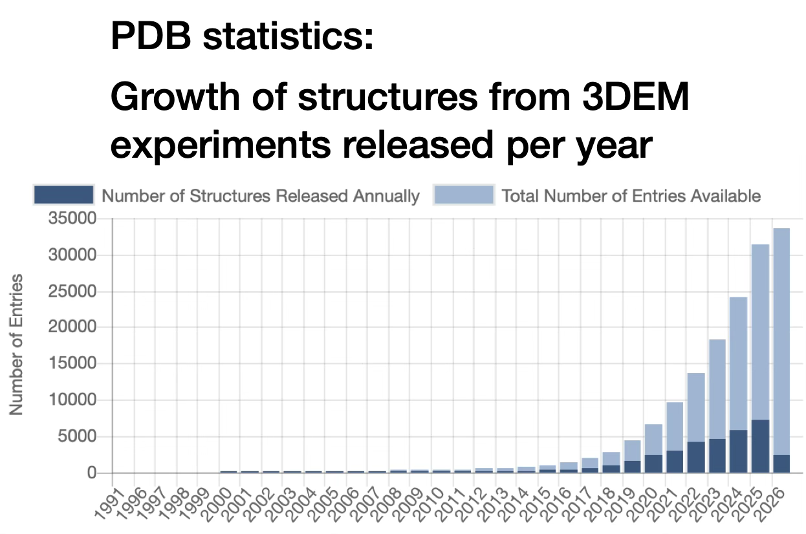

# Self-supervised spatial features for protein detection  in crowded cryo-ET tomograms

**Bogdan Toader**\
MRC Laboratory of Molecular Biology

 

CCP-EM Spring Symposium\
24 April 2026, Nottingham

---
### Challenge: comprehensive identification of structures in cryo-ET tomograms

  

Ribosomes and S-layer proteins are abundant and high-contrast,\
but what about the **smaller, rarer proteins in the crowded cellular environment**?
<!-- .element: class="fragment" -->

 

<a href="https://www.nature.com/articles/s41586-024-07462-5" class="citation">von Kügelgen *et al.* Nature 2024</a>

Note: some notes

---
### Challenge: comprehensive identification of structures in cryo-ET tomograms

<!-- .slide: class="left" -->

   

Current approaches:

* Manual annotation: slow for many tomograms  <!-- .element: class="fragment" -->

* Template matching: slow (N passes for N types) + requires templates  <!-- .element: class="fragment" -->

* Deep learning models:  <!-- .element: class="fragment" -->

  * Require annotated data  <!-- .element: class="fragment" -->

  * General purpose segmentation models only suitable for large structures  <!-- .element: class="fragment" -->

  * Contrastive specialised models embed one particle at a time  <!-- .element: class="fragment" -->

---
### Challenge: comprehensive identification of structures in cryo-ET tomograms

<!-- .slide: class="middle" -->

Lots of available data

 <!-- .element: height="500" class="fragment" data-fragment-index="1"-->
 <!-- .element: height="500" class="fragment" data-fragment-index="2"-->

Why not use it? <!-- .element: class="fragment green" data-fragment-index="3"-->

<a href="https://www.rcsb.org/stats/growth/growth-em" class="citation fragment" data-fragment-index="1">https://www.rcsb.org/stats/growth/growth-em</a>
<a href="https://alphafold.com" class="citation fragment" data-fragment-index="2">https://alphafold.com</a>

---
### Challenge: comprehensive identification of structures in cryo-ET tomograms

<!-- .slide: class="left" -->

 

Self-supervised learning on simulated cryo-ET data: **TomoFind** <!-- .element: class="tfblue" -->
* Requires annotated data <!-- .element: class="fragment fade-in-then-out"-->
  * “Infinite” amount of simulated data <!-- .element: class="fragment green"-->

* General purpose segmentation models only suitable for large structures<!-- .element: class="fragment fade-in-then-out"-->
  * Train with noisy, corrupted data <!-- .element: class="fragment green"-->

* Contrastive specialised models embed one particle at a time<!-- .element: class="fragment fade-in-then-out"-->
  * Simulate crowding in cellular environment<!-- .element: class="fragment green"-->

  

**Long-term goal:** template (and hassle)-free identification of structures in tomograms
<!-- .element: class="fragment"-->

---

<!-- .slide: class="center" style="font-size: 1.3em" -->

1. Self-supervised learning on simulated cryo-ET data
2. Crowding robustness
3. Template-free detection + classification example

<!-- .element: style="line-height: 2.0" -->

---

<!-- .slide: class="center" style="font-size: 1.3em" -->

1. Self-supervised learning on simulated cryo-ET data  <!-- .element: class="listcurrent" -->
2. Crowding robustness <!-- .element: class="gray" -->
3. Template-free detection + classification example <!-- .element: class="gray" -->

<!-- .element: style="line-height: 2.0" -->

---
### SSL on simulated cryo-ET data: data simulation pipeline

<!-- .slide: class="middle" -->

Place particles in volume at random positions

<video src="img/data_simulation/big_only_zslices.mp4" data-autoplay loop muted></video>

Generate crowded environment

<video src="img/data_simulation/clean_zslices.mp4" data-autoplay loop muted></video>

Project + add noise to tilt images

<video src="img/data_simulation/tilts_noisy_dose_weighted.mp4" data-autoplay loop muted></video>

Reconstruct tomogram

<video src="img/data_simulation/simulated_zslices.mp4" data-autoplay loop muted></video>

  

<a href="https://www.nature.com/articles/s41592-023-01878-z" class="citation">
~130 PDB_IDs from Rice, G., Wagner, et al. Nat Methods 2023
</a>

